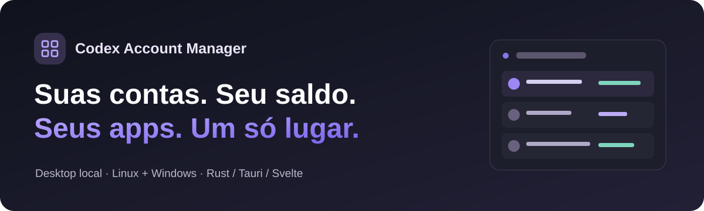

  

  
  
  
  
  

# Suas contas. Seu saldo. Seus apps. Um só gerenciador.

**Um painel desktop para organizar suas próprias contas do Codex, acompanhar os limites de uso e disponibilizar contas autorizadas para suas aplicações locais — sem transformar cada troca em uma caça a perfis, logins e arquivos.**

Você programa no Codex. Um projeto seu também precisa executar uma tarefa com uma conta específica. Outra conta fica reservada para outro aplicativo. O gerenciador reúne essa organização em uma interface local, com grupos, permissões e uma ponte para desenvolvimento.

> Projeto independente e experimental. Não é um produto oficial da OpenAI, não inclui assinatura ou acesso ao Codex e não elimina os limites ou as regras do serviço.

## O que ele faz

| Para você | Para suas aplicações |
| --- | --- |
| Organiza contas e perfis de navegador separados | Autoriza contas específicas ou grupos pela interface |
| Mostra uso observado, horários de reset e planos informados | Oferece CLI local e SDKs Python/TypeScript |
| Recomenda uma próxima conta entre as elegíveis | Supervisiona execuções efêmeras com `codex exec` |
| Alterna a conta do Codex com validação e preservação de estado | Abre sessões App Server para o harness do seu projeto |
| Filtra grupos, busca com tolerância a erros e oferece ações contextuais | Mantém a identidade selecionada durante o trabalho |
| Permite arquivar, restaurar, desvincular ou excluir com confirmação | Mantém os tokens OAuth fora das respostas da API |

**Também tem:** tema claro/escuro/sistema, navegação por teclado, perfis de navegador gerenciados, e-mail opcional, diagnóstico sanitizado e controles de disponibilidade por conta.

### Aplicações: autorize uma vez, use os recursos aprovados

1. Seu aplicativo solicita conexão pela CLI ou pelo SDK.
2. Você confere o pedido e escolhe contas, grupos, ações e duração na interface.
3. O aplicativo executa com esse acesso — sem um cadastro extra de vínculo.

Na **alpha.8**, uma conta já conectada pode atender aplicações sem outro login exclusivo. O gerenciador prepara o acesso em ambiente isolado e conserva o controle da renovação. Sessões dedicadas de versões anteriores continuam preservadas.

Pedidos de ampliação de acesso exigem nova aprovação. Saber o nome de uma aplicação ou colocar uma conta num grupo não equivale a receber permissão.

## Começar

- **Downloads e histórico:** [GitHub Releases](https://github.com/KingDonRush/codex-account-manager/releases).
- **Compilar:** [guia de desenvolvimento](docs/development.md).
- **Integrar um app:** [receitas Python/TypeScript e App Server](docs/integration-harnesses.md).
- **Segurança e limitações:** [contrato de segurança](docs/security-0.5.md) e [SECURITY.md](SECURITY.md).
- **Atualizar preservando os dados:** [guia de atualização](docs/hotfix-upgrade-0.3-0.5.md).

As releases históricas registram o que foi possível verificar e publicar. Não presuma que toda versão possui os dois instaladores, que todos os pacotes representam a fonte atual ou que uma versão antiga contém os recursos descritos aqui.

## Estado honesto do projeto

O snapshot público parte da **0.5.0-alpha.8**. A interface, o backend e os SDKs possuem testes de contrato, interação e integração; isso **não** significa ausência de bugs ou homologação universal de contas, sistemas e versões do Codex.

- **Windows:** abra normalmente, sem executar como administrador. A execução elevada apresentou falha no controle privado do navegador. Fechamento/reabertura automática do Codex ainda tem relatos de falha e pode exigir recuperação manual.
- **Autenticação:** falhas de rede, cofre ou identidade não são equivalentes a credencial revogada. O aplicativo pode precisar de intervenção humana quando a sessão realmente não puder ser recuperada.
- **Uso e recomendação:** amostras podem ficar antigas; inferências após reset devem ser diferenciadas de respostas observadas do serviço.
- **Execuções longas:** o harness App Server possui interação com o host para renovação; `codex exec` com acesso externo não possui esse callback dentro do job.
- **Isolamento:** o gerenciador não é uma sandbox contra malware do mesmo usuário, nem aprova automaticamente ferramentas do aplicativo consumidor.
- **Compatibilidade:** mudanças no Codex, no navegador e no sistema operacional podem exigir ajustes. macOS não foi homologado.

## Local por projeto, explícito por permissão

As contas permanecem no gerenciador. O frontend recebe metadados; o cofre nativo conserva credenciais; o processo de execução recebe o contexto necessário. O transporte usa socket Unix no Linux e Named Pipe local no Windows, sem abrir uma API pública de rede para as integrações.

Use somente contas e recursos que você está autorizado a usar. Este projeto não vende contas, não compartilha assinaturas entre pessoas e não contorna limites do serviço.

## Contribuir

Encontrou uma falha? Abra uma issue com versão, sistema operacional, ação esperada, resultado observado e passos mínimos de reprodução. **Não envie** credenciais, cookies, bancos, perfis de navegador, URLs completas de OAuth, capturas de conversas ou dados pessoais. Veja [CONTRIBUTING.md](CONTRIBUTING.md).

## English summary

**Codex Account Manager is an experimental, local-first desktop app for managing your own Codex accounts and authorizing local applications to use selected accounts or groups.** It combines usage visibility, account switching, managed browser profiles and Python/TypeScript clients for supervised exec and App Server harnesses. Linux and Windows are the current targets. It is independent from OpenAI; known limitations are documented rather than hidden.

## Licença e terceiros

Código do projeto sob [MIT](LICENSE). Bibliotecas, runtimes e marcas de terceiros mantêm suas próprias licenças e direitos; veja [THIRD_PARTY_NOTICES.md](THIRD_PARTY_NOTICES.md).
